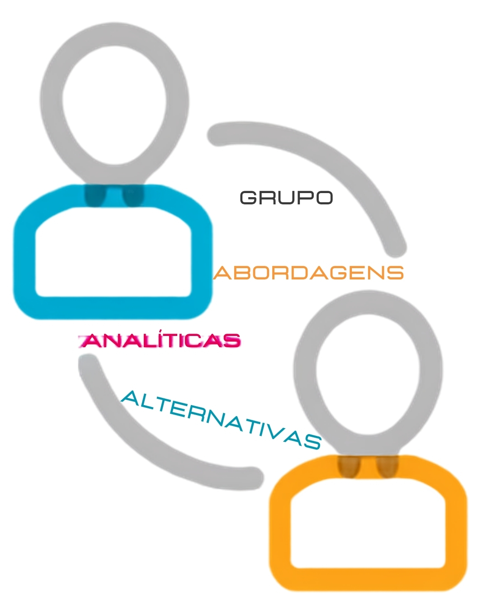
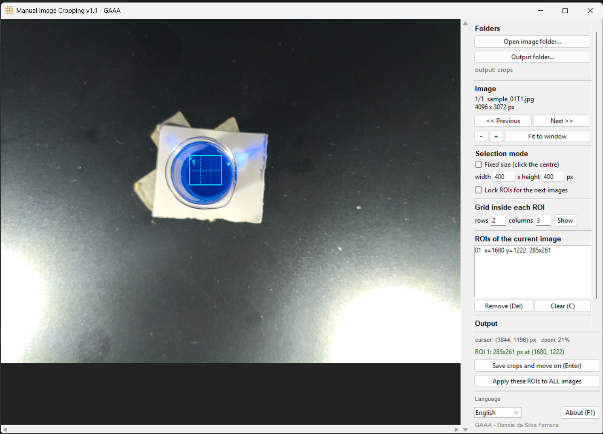
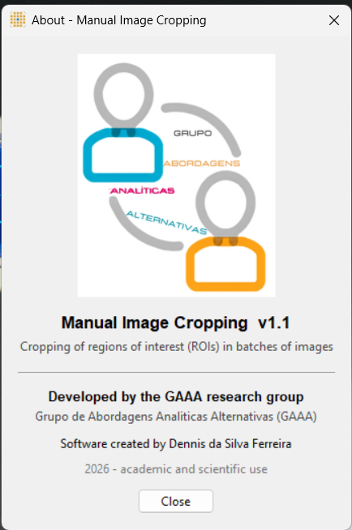

<div align="center">



# Manual Image Cropping

**A desktop tool for cropping regions of interest (ROIs) from batches of images,
with every ROI logged to CSV so that the cropping step is reproducible.**


Developed by the **GAAA** research group · Software created by **Dennis da Silva Ferreira**

</div>

---

## The problem

When working with digital images in analytical chemistry, each photograph of a sample has to
become several sub-images cropped from the same region, at the same size, so that colour
histograms are comparable across samples. Doing this by hand in an image editor is slow,
inconsistent and, worst of all for a paper, **not reproducible**: nobody can repeat
exactly the same crops afterwards.

This program solves the three points: selection is visual, the size can be locked, and
**every ROI applied is written to a CSV** that reproduces identical crops at any time,
on any computer.



<sub>Photograph of an e-waste leachate sample. The ROI drawn over the sample disc is divided
into a 2 × 3 grid, that is, six sub-images extracted from this single photo, all at the
original resolution and with their coordinates logged to CSV.</sub>

## Features

| Feature | What it does |
|---|---|
| **Free selection** | drag a rectangle over the region of interest in each image |
| **Fixed size** | set `width × height` in pixels and just click the centre; every crop comes out identical, which is essential for comparing histograms |
| **Locked ROIs** | mark the region once and reuse it on the following images (tripod/scanner shots) |
| **Grid inside the ROI** | split each region into `rows × columns`, multiplying the sub-samples per photo |
| **Apply to all** | process the whole folder with the current ROIs, in one click |
| **Original resolution** | zoom is visual only; the crop always comes out at the photograph's resolution |
| **Coordinate CSV** | `crop_coords.csv` records every crop and lets you redo them later |
| **EXIF correction** | the orientation recorded by the camera is applied before cropping |
| **Batch / CLI mode** | the same code runs without a window, for pipelines and notebooks |
| **Bilingual interface** | English and Portuguese, switched from the panel without restarting; the choice is remembered |
| **Fits any screen** | the action buttons are pinned to the bottom and the controls scroll, so nothing is ever cut off |

### Keyboard shortcuts

| Key | Action | Key | Action |
|---|---|---|---|
| `Enter` | save the crops and move on | `Del` | remove the last ROI |
| `←` `→` | change image | `C` | clear the ROIs |
| `+` `-` `0` | zoom (or `Ctrl`+mouse wheel) | `T` | lock/unlock the ROIs |
| `F1` | "About" window | | |

## Download and use (Windows)

1. Download **[ManualImageCropping.exe](../../releases/latest)** (or take it from
   [`executable/ManualImageCropping.exe`](executable/ManualImageCropping.exe) in this
   repository).
2. Double-click it. **No need to install Python or anything else.** The logo, the icon and
   every library travel inside the executable (~19 MB).
3. `Open image folder...` → `Output folder...` → draw the ROIs → `Enter`.

> **Language:** the interface is available in **English** and **Portuguese**. Use the
> selector at the bottom of the control panel to switch at any moment. The window changes
> immediately, without losing the ROIs you have already drawn, and the choice is remembered
> for the next run. The first run follows the language of the operating system.

> **SmartScreen:** the executable is not digitally signed (a code-signing certificate is
> paid), so on first run Windows may warn that *"Windows protected your PC"*. Click
> **More info → Run anyway**. The full source code is here in the repository for auditing,
> and the `.exe` can be rebuilt by anyone with the command in the section below.

Want to try it without images at hand? The folder
[`examples/sample_image/`](examples/sample_image) ships one sample photograph (the same one
in the screenshot above), ready to crop.

## Use as a Python library

The same file is importable, which is how it goes into analysis notebooks:

```python
from pathlib import Path
import manual_cropping as mc

# 1) selection window
mc.open_window(Path('images/original'), Path('images/crops'), 'jpg')

# 2) the same ROI over the whole folder, each one split into 2x3 sub-crops
mc.apply_in_batch('images/original', 'images/crops',
                  rois=[(300, 200, 600, 400)],
                  n_rows=2, n_cols=3, fmt='png')

# 3) redo exactly the crops of an earlier session
mc.redo_from_csv('images/crops/crop_coords.csv',
                 'images/original', 'crops_redone', fmt='png')
```

Or from the command line:

```powershell
python manual_cropping.py --input images --output crops --roi 300,200,600,400 --grid 2x3 --batch
python manual_cropping.py --input images --output crops2 --csv crops/crop_coords.csv
python manual_cropping.py --lang pt          # open the window in Portuguese
```

The notebook
[`examples/manual_cropping_example.ipynb`](examples/manual_cropping_example.ipynb)
shows the full workflow: open the window, apply in batch, check the crops as a mosaic and
redo everything from the CSV.

### Public API

| Function | Purpose |
|---|---|
| `list_images(folder)` | sorted list of the images in a folder |
| `open_image(path)` | open as RGB, applying the EXIF orientation |
| `clamp_roi(x, y, width, height, bounds)` | fit an ROI inside the image |
| `split_into_grid(roi, n_rows, n_cols)` | split one ROI into a grid of blocks |
| `save_crops(image_path, rois, output_folder, ...)` | crop one image and return the CSV records |
| `log_to_csv(output_folder, records)` | append the records to `crop_coords.csv` |
| `apply_in_batch(input_folder, output_folder, rois, ...)` | apply the ROIs to a whole folder |
| `redo_from_csv(csv_path, input_folder, output_folder, ...)` | reproduce the crops of an earlier session |
| `open_window(input_folder, output_folder, fmt, language)` | open the graphical interface |

## Tests

```powershell
python tests/test_manual_cropping.py
```

No test runner is required. The suite covers the cropping core, the coordinate CSV (including
files written by version 1.0), the two language tables, the command line, and the panel
layout at six window sizes, checking that the action buttons stay on screen and that the
panel scrollbar appears exactly when the controls do not fit.

## Building the executable

```powershell
pip install -r requirements.txt
pyinstaller ManualImageCropping.spec --noconfirm --clean
```

The result lands in `dist\ManualImageCropping.exe`. On Windows, `build_exe.bat` runs the
three steps (dependencies → icon → build) with a double-click.

## Repository layout

```
manual_cropping.py          program code: core, Tkinter interface and CLI
ManualImageCropping.spec    PyInstaller recipe (what goes into the executable)
exe_version.txt             authorship/version shown in Properties > Details
build_exe.bat               builds everything in one step
requirements.txt            Pillow (program) + PyInstaller (build)
assets/                     program icon and the GAAA logo shown in "About"
docs/                       screenshots used in this README
examples/                   usage notebook and one sample image for testing
executable/                 ManualImageCropping.exe, ready to download
tests/                      test suite, runnable with plain Python
```

The file `manual_cropping.py` is split into three independent blocks: the **interface-free
core** (cropping, grid, CSV), the **graphical interface** and the **command line**. The core
does not import Tkinter, so it runs the same way on a server, in a notebook or inside the
window.

## Version history

| Version | Changes |
|---|---|
| **1.1** | Bilingual interface (English/Portuguese) with live switching and a remembered choice, plus `--lang`. Code, file names, command-line arguments and CSV columns translated to English; CSV files written by 1.0, with Portuguese column names, are still accepted by `redo_from_csv`. New program icon. Added a test suite. **Fixed:** the control panel needed 818 px of height while the window never exceeded 780 px, so the *save and move on* and *apply to all* buttons were cut off, and on smaller screens the program became unusable. The actions are now pinned to the bottom, the controls above them scroll, and the window is placed inside the usable area of the screen. |
| **1.0** | First public release. |

## About



**Developed by the GAAA research group**
Grupo de Abordagens Analíticas Alternativas (Alternative Analytical Approaches Group)

**Software created by Dennis da Silva Ferreira**

Written for image processing in analytical chemistry, and published here so that other groups
can use it and so that the crops of any work done with it are reproducible by third parties.

<br clear="right">

## License

[MIT](LICENSE). Free to use, including commercially, as long as the authorship notice is
kept. If this program helps in academic work, a citation to GAAA is welcome.

---

<details>
<summary><b>Resumo em português</b></summary>

**Manual Image Cropping** é uma ferramenta de janela (Tkinter + Pillow) para recortar regiões
de interesse (ROIs) de lotes de imagens, feita para análise de histogramas de cor em química
analítica.

Os recortes saem sempre na resolução original, toda ROI é registrada em `crop_coords.csv`, e
esse CSV refaz os recortes idênticos depois, o que torna a etapa de pré-processamento de
imagens de um artigo reprodutível por terceiros. Tem seleção livre, seleção de tamanho fixo,
ROIs travadas entre imagens e uma grade `n × m` dentro de cada ROI que multiplica as
sub-amostras por fotografia. É distribuída como executável único para Windows (sem precisar
de Python) e também funciona como módulo Python importável, para notebooks e processamento
em lote.

A interface está em **português e inglês**, com troca pelo seletor no rodapé do painel, sem
reiniciar e sem perder as ROIs já marcadas; a escolha fica gravada para a próxima vez. O
código, os nomes de arquivos e os argumentos da linha de comando estão em inglês desde a
versão 1.1, e CSVs gerados pela versão 1.0, com as colunas em português, continuam sendo
aceitos por `redo_from_csv`.

Desenvolvido pelo grupo de pesquisa GAAA (Grupo de Abordagens Analíticas Alternativas).
Software criado por Dennis da Silva Ferreira. Licença MIT.

</details>
